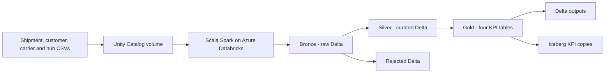
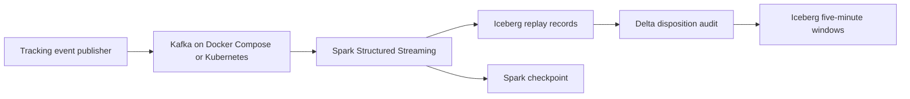
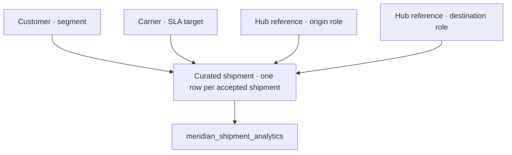

# Batch and Streaming Architecture

## Batch flow

## Streaming flow

The finite replay and continuous live consumer use separate topics, checkpoints, and warehouses. The local live demo runs Kafka and Spark with Docker Compose; Kubernetes supports the persistent-volume and ADLS-backed deployment paths. Continuous mode uses a two-second processing-time trigger by default, while actual end-to-end delay depends on micro-batch processing time. The ADLS acceptance run stores its checkpoint, Iceberg warehouse, and Delta audit in ADLS Gen2 while Kafka and Spark compute remain on local Kubernetes. See the [replay and recovery record](../Logging/meridian-adls-recovery-verification.log).

## Shipment analytics model

The Databricks notebook builds a star-style analytics view from the curated shipment table and four reference roles. The two hub aliases use the same source reference. [Batch notebook](../Data%20Ingestion/Batch/01_Shipments_Batch.scala) · [KPI catalogue](../Dashboard/README.md)
