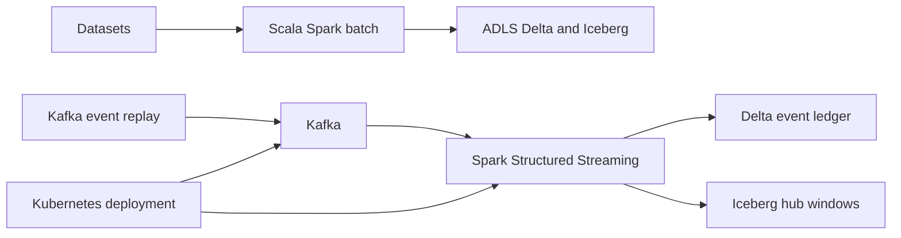

# Architecture

Meridian combines a historical batch pipeline with a Kafka-based tracking stream. Both use the project datasets; the batch pipeline publishes curated and KPI data, while streaming maintains an event ledger and hub-window aggregates.

See [the project guide](../README.md), [batch source](../Data%20Ingestion/Batch/src/main/scala/meridian/BatchJob.scala), and [streaming source](../Data%20Ingestion/Streaming/MeridianStreaming.scala).
